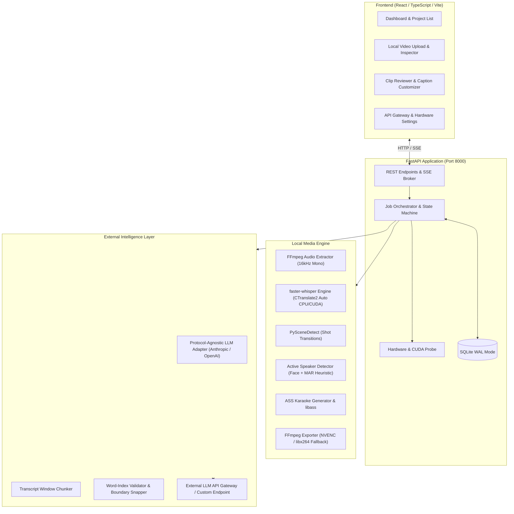
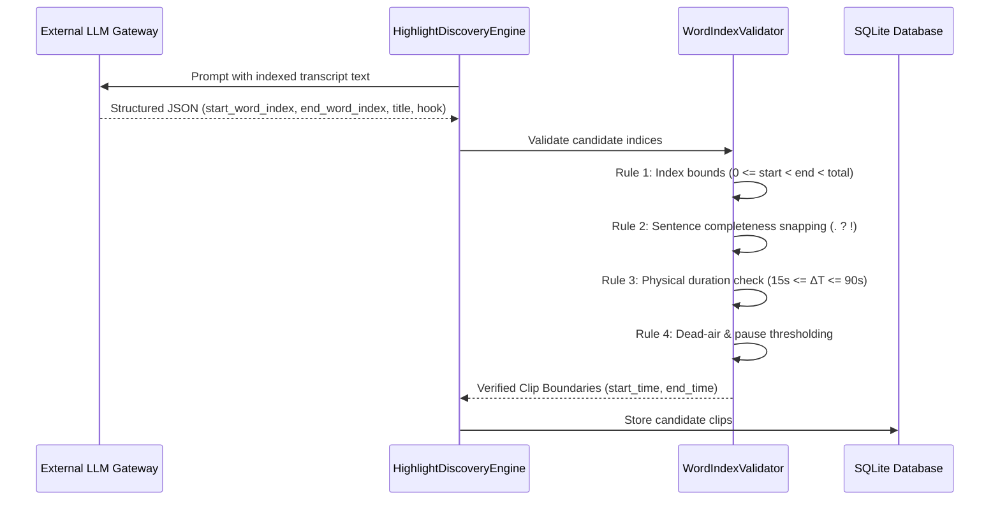
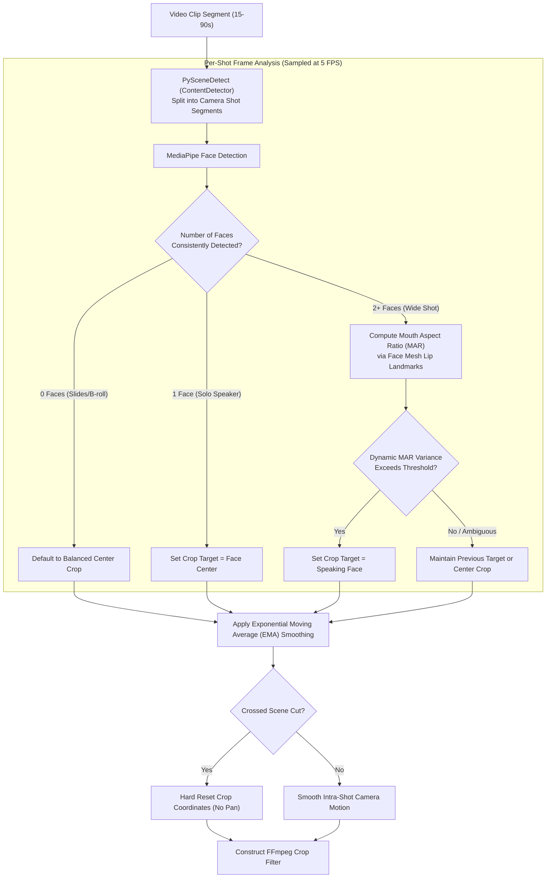
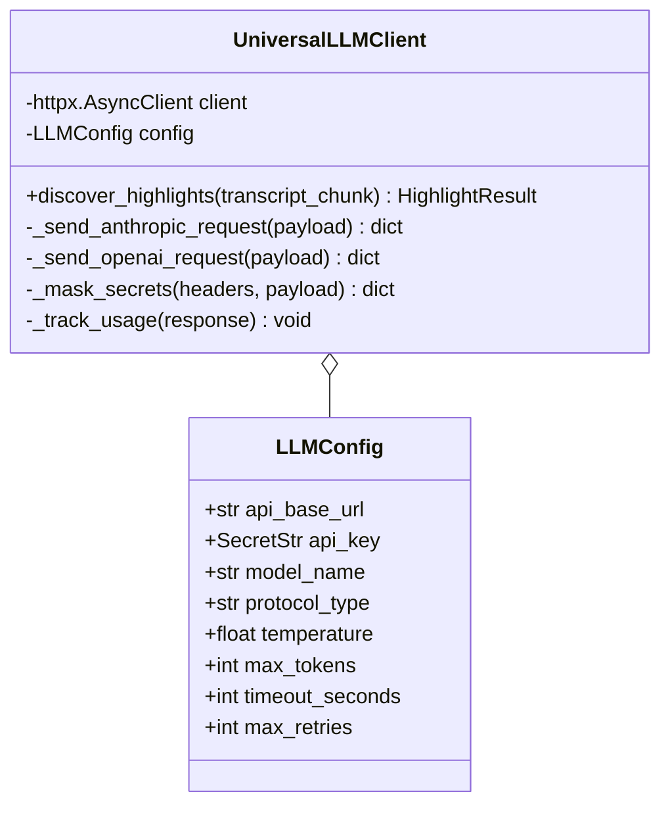
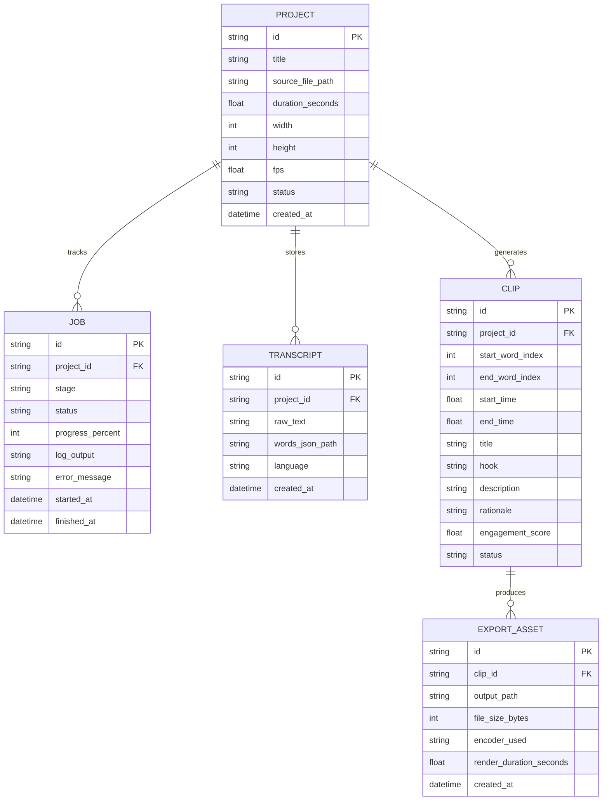

# ClipForge AI — System Architecture Specification

**Author:** ClipForge Architecture & Engineering Team  
**Date:** November 2026  
**Document Version:** 1.1.0 (Post-Validation Revision)  
**Phase:** Phase 1 — Research & Planning

---

## 1. System Overview & Architectural Principles

ClipForge AI is an asynchronous, local-first desktop application designed to run smoothly on standard Windows 11 hardware while leveraging external LLM intelligence strictly for semantic tasks.

### 1.1 Refined MVP Scope
To ensure technical feasibility, stability, and fast execution, the MVP scope is strictly disciplined:
- **Included in MVP:**
  1. Local video file upload (`.mp4`, `.mov`, `.mkv`, `.webm`).
  2. Local audio extraction to standardized 16kHz mono WAV.
  3. Local word-level transcription with timestamps via `faster-whisper`.
  4. External AI highlight discovery with word-index anchoring.
  5. Deterministic boundary validation and physical timestamp extraction.
  6. Basic vertical 9:16 cropping with camera shot cut protection.
  7. Basic synchronized animated captions (karaoke style).
  8. High-quality MP4 export.
  9. Configurable LLM API connection tester.
- **Deferred Post-MVP:**
  - YouTube URL downloading via `yt-dlp` (prioritize local file workflows first).
  - Complex multi-speaker split-screen layouts.
  - Generative AI b-roll injection.
  - Direct cloud publishing to TikTok/Instagram.

---

## 2. Core Subsystems & Components

### 2.1 Hardware Detection & Adaptive Inference Engine
Before initiating any processing stage, the `HardwareDetector` inspects system capabilities:
1. **CUDA / VRAM Probe:** Checks `ctranslate2.get_cuda_device_count()`. If CUDA is available and dedicated VRAM is $\ge 4.0\text{ GB}$, the engine defaults to `device="cuda"` with `compute_type="float16"` (or `int8_float16`).
2. **CPU Fallback Mode:** If no CUDA GPU is detected, or if VRAM $< 4.0\text{ GB}$, the engine automatically configures:
   - `device="cpu"`
   - `compute_type="int8"`
   - Default model size: `base` or `small` (preventing CPU thread starvation).
3. **User Override:** In Settings, the user can manually pin the model (`tiny`, `base`, `small`, `medium`, `large-v3-turbo`) and device (`auto`, `cpu`, `cuda`).

### 2.2 Word-Index Highlight Discovery & Validation Subsystem
LLMs struggle with floating-point numerical calculations and timestamps. ClipForge uses a **two-phase highlight extraction and validation protocol**:

#### Detailed Validation Rules:
1. **Index Integrity:** $0 \le \text{start\_word\_index} < \text{end\_word\_index} < \text{len}(\text{words})$. Out-of-bounds or inverted ranges are rejected immediately.
2. **Sentence Boundary Snapping:**
   - Scan backward from `start_word_index` up to 10 words. Snap to the first capitalized word following terminal punctuation or an audio silence gap $> 0.75\text{s}$.
   - Scan forward from `end_word_index` up to 10 words. Snap to the first word ending with terminal punctuation (`.`, `?`, `!`) or followed by a silence gap $> 0.75\text{s}$.
3. **Duration Constraints:**
   - Physical duration is derived strictly from Whisper's word timings:
     $$\Delta T = \text{words}[\text{end\_idx}].\text{end} - \text{words}[\text{start\_idx}].\text{start}$$
   - Enforce: $15.0\text{s} \le \Delta T \le 90.0\text{s}$. If outside bounds, the candidate is adjusted or discarded.
4. **Silence & Coherence Check:** If the selection contains an unvoiced gap $> 3.0\text{s}$, the clip is flagged for internal trimming or rejected.

---

### 2.3 Active Speaker Detection & Reframing Pipeline

MediaPipe face detection outputs bounding boxes, but does **not** identify who is speaking. ClipForge implements a lightweight, 3-tier active speaker heuristic optimized for Windows 11 laptops:

1. **Shot Segmentation:** `PySceneDetect` detects visual cut transitions. Crop coordinates **never interpolate across shot cuts**, preventing disorienting camera sweeps.
2. **Single-Face Shots:** If a shot contains only one dominant face, that face is automatically designated the crop anchor.
3. **Multi-Face Shots (Mouth Aspect Ratio):** Lip landmarks are tracked to calculate $\text{MAR} = \frac{|y_{\text{upper}} - y_{\text{lower}}|}{|x_{\text{corner\_left}} - x_{\text{corner\_right}}|}$. Sustained variance over a 0.6s window identifies active speech.
4. **Dwell Time & Center Fallback:** Focus will not shift between faces faster than once every 2.5 seconds. If speech confidence is ambiguous, the engine defaults to a wide center crop.

---

### 2.4 Subtitle & Animation Engine
1. Word-level timestamps from Whisper are formatted into an Advanced SubStation Alpha (`.ass`) file.
2. Animated karaoke highlighting is produced using `{\k<centiseconds>}` tags:
   - Primary active color: High-visibility vibrant yellow (`&H0000FFFF`).
   - Secondary inactive color: High-contrast white (`&H00FFFFFF`).
   - Strong outline (`&H00000000`) and subtle box shadow to ensure readability against any background.
3. Rhythmical grouping: Subtitles are grouped into 2 to 4 words per line to maintain viral short-form reading tempo.

---

### 2.5 Provider-Independent AI Integration Layer

#### Protocol Adaptability:
- **`CLIPFORGE_LLM_PROTOCOL="openai_compatible"`**: Formats requests to `/v1/chat/completions` using standard `Bearer` authentication. Compatible with OpenAI, OpenRouter, LiteLLM, vLLM, and Ollama.
- **`CLIPFORGE_LLM_PROTOCOL="anthropic"`**: Formats requests to `/v1/messages` using `x-api-key` and `anthropic-version: 2023-06-01`.
- **Secret Redaction:** A dedicated logging wrapper masks all headers matching `Authorization`, `x-api-key`, and `api-key` before sending log entries to console or file storage.

---

## 3. Database Schema (SQLite WAL Mode)

---

## 4. Hardware Sizing & Performance Classification

> **[HARDWARE-DEPENDENT ESTIMATES]**  
> Throughput depends on CPU core count, thermal dissipation, and GPU architecture.

| Hardware Tier | CPU & RAM | GPU Profile | Expected Transcription RTF (`faster-whisper`) | Expected Export Speed (1080x1920) |
| :--- | :--- | :--- | :--- | :--- |
| **Tier 1 (Budget Laptop)** | 4 cores / 8GB RAM | Integrated (Intel UHD / Iris / Radeon) | RTF $\sim 0.20 - 0.35$ (`base` / `small` INT8) | $\sim 0.6\times - 0.9\times$ Real-Time (`libx264`) |
| **Tier 2 (Midrange Laptop)**| 6-8 cores / 16GB RAM| Integrated / Entry GPU (<4GB VRAM) | RTF $\sim 0.10 - 0.20$ (`small` INT8) | $\sim 1.0\times - 1.5\times$ Real-Time (`libx264` / QSV) |
| **Tier 3 (Creator Laptop)** | 8+ cores / 16GB-32GB | NVIDIA RTX 3060/4060+ (6GB+ VRAM) | RTF $\sim 0.03 - 0.07$ (`medium` / `large-v3-turbo` FP16) | $\sim 4.0\times - 8.0\times$ Real-Time (`h264_nvenc`) |
