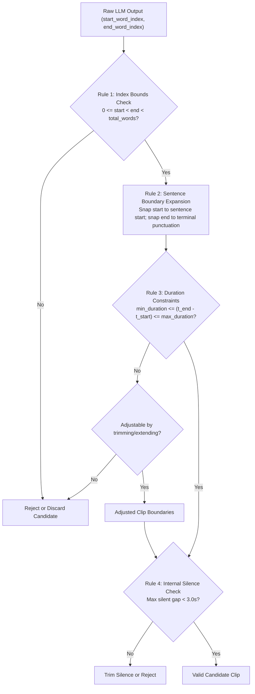

# ClipForge AI — Technical Research & Repository Evaluation Report

**Author:** ClipForge Architecture & Engineering Team  
**Date:** November 2026  
**Document Version:** 1.1.0 (Post-Validation Revision)  
**Phase:** Phase 1 — Research & Planning

---

## 1. Executive Summary

ClipForge AI is designed as a **local-first desktop application** that ingests long-form video content and produces engaging, high-retention vertical short clips (9:16) for TikTok, Instagram Reels, and YouTube Shorts.

This updated report incorporates technical validation feedback:
- **Refined MVP Scope:** The MVP focuses strictly on local video upload, audio extraction, word-level transcription, AI highlight discovery, candidate clip timestamping, basic vertical cropping, basic animated captions, and MP4 export. Advanced multi-speaker split layouts and cloud features are deferred.
- **Realistic Active Speaker Detection:** Clear separation between visual face detection and active speaker identification. We evaluate a lightweight mouth-aspect-ratio (MAR) visual speech metric versus audio diarization and propose a robust, low-overhead MVP heuristic.
- **Accurate Word-Index Highlight Analysis:** Complete breakdown of the errors word-index anchoring prevents, what it cannot prevent, and the required post-LLM validation rules.
- **Hardware-Dependent Performance Claims:** All performance figures are explicitly classified as hardware-dependent estimates, paired with a reproducible benchmarking methodology.
- **Strict Licensing Boundaries:** Definitive licensing inventory, explicit exclusion of `mutonby/openshorts` proprietary `cloud/` directory, and analysis of `artbyjazi/autoclip` and other dependencies.
- **Dynamic Hardware Sizing & Fallbacks:** Graceful degradation from CUDA GPU to CPU `int8` with configurable model selection.
- **Provider-Independent API Protocol Adapter:** Support for Anthropic, OpenAI-compatible, and custom gateway protocols with complete credential masking.

---

## 2. Comprehensive Repository Comparison Table

| Repository | Primary Tech Stack | License | Windows 11 Native | Hardware Req. (Min / Rec) | Main Strengths | Primary Weaknesses / Limitations | Commercial Reuse Recommendation |
| :--- | :--- | :--- | :--- | :--- | :--- | :--- | :--- |
| **`artbyjazi/autoclip`** | Python, FastAPI, SQLite (WAL), React, TS, FFmpeg, Whisper, MediaPipe | **MIT** (Fonts: SIL OFL) | **Full Native Support** | CPU: 4 cores / RAM: 8GB GPU: Optional | Word-index highlight anchoring; Resumable state machine; Shot-boundary aware cropping; Clean decoupled architecture. | Default Whisper uses PyTorch (needs swap to faster-whisper); Basic active-speaker heuristic. | **Primary Technical Reference** (Adopt pipeline structure, word-index prompt patterns, and crop smoothing logic). |
| **`mutonby/openshorts`** (`YoYoZ/openshorts`) | Python, FastAPI, React, Docker, faster-whisper, MediaPipe, YOLOv8 | **Split:** Core is **MIT**; `cloud/` is **Commercial / Non-Compete** | **Supported** (Docker or Native) | CPU: 6 cores / RAM: 16GB GPU: 6GB+ VRAM | Built-in `faster-whisper`; PySceneDetect cut detection integration. | **`cloud/` directory has restrictive commercial terms**; Cloud bloat (ElevenLabs, fal.ai). | **Selective Reference Only** (Study scene detection; **Strictly blacklist/exclude `cloud/` directory**). |
| **`Batuktech/Cutroom`** | Python, Local Qwen3-8B / Claude Code, Whisper, FFmpeg | **MIT** (Permissive) | **Partial** (Heavy setup) | CPU: 8 cores / RAM: 32GB GPU: 12GB+ VRAM | Stream VOD autopilot; Direct local LLM workflow. | Massive local compute requirements; impractical on standard Windows 11 laptops. | **Inspirational Only** (Do not bundle heavy local LLMs). |
| **`paundrapf/PaunClip`** | Electron, Python backend, Whisper | **NO LICENSE** (All Rights Reserved) | **Supported** (Electron) | Standard laptop | Desktop-centric packaging; clean UI layout. | **Severe IP Risk:** No open-source license. Default copyright prohibits copying code. | **Zero Code Reuse** (Do not copy any code or assets). |
| **`shahid2866/fluxclip`** | AutoHotkey / Misc | N/A | Windows Native | Minimal | N/A | Repository does not exist or was deleted/renamed. | **Non-viable / Discard.** |
| **`SYSTRAN/faster-whisper`** | CTranslate2, C++, Python, Silero VAD | **MIT** | **Full Native Support** (pip wheel) | CPU: 4 cores / RAM: 4GB GPU: Optional | High inference throughput; INT8 quantization; ~60% less VRAM; Built-in Silero VAD. | First-run model download (~140MB–1.5GB depending on model tier). | **Adopt as Core Transcription Engine.** |
| **`openai/whisper`** | PyTorch, Python | **MIT** | **Supported** (Requires PyTorch) | CPU: High / RAM: 8GB+ GPU: 6GB–10GB VRAM | Official OpenAI reference; High transcription accuracy. | Slow sequential Python decoding; High VRAM consumption; prone to CUDA OOM on laptops. | **Do Not Use in Production** (Superseded by faster-whisper). |
| **`FFmpeg/FFmpeg`** | C, Assembly | **LGPL v2.1+** (or GPL if configured) | **Full Native Support** (Static builds) | Any modern CPU | Industry standard media manipulation; Hardware acceleration (NVENC, QSV, AMF); `libass`. | CLI complexity; Subprocess handling must be robust against deadlocks. | **Adopt as Core Media Engine** (External CLI execution; unbundled LGPL binary). |
| **`yt-dlp/yt-dlp`** | Python | **The Unlicense** (Public Domain) | **Full Native Support** | Minimal | Most robust YouTube/stream extractor; Actively maintained. | YouTube bot countermeasures; Post-MVP priority. | **Deferred / Post-MVP** (Focus first on local file upload). |
| **`Breakthrough/PySceneDetect`**| Python, PyAV / OpenCV | **BSD 3-Clause** | **Full Native Support** | Minimal CPU | Fast hard cut detection; Frame-accurate; Native downscaling support. | Decoding speed depends on backend (PyAV recommended). | **Adopt for Cut & Shot Boundary Detection.** |
| **`pyannote/pyannote-audio`** | PyTorch, Torchaudio | **MIT** (Code), **Gated HF** (Models) | **Problematic** (Linux/WSL native) | CPU: 6 cores / RAM: 16GB GPU: 4GB+ VRAM | State-of-the-art acoustic diarization ("who spoke when"). | Does not output video bounding boxes; HuggingFace gating; Fragile native Windows compilation. | **Reject for MVP Reframing** (Use visual face tracking + shot detection). |

---

## 3. Deep-Dive Repository Analysis & Licensing Audit

### 3.1 `artbyjazi/autoclip`
- **License:** Core code is under the **MIT License**. Bundled typography assets are under the **SIL Open Font License**.
- **Architecture:** FastAPI backend with SQLite (WAL mode) and React frontend.
- **Highlight Discovery Mechanism:** Anchors highlight requests to word indices (`start_word_index`, `end_word_index`) rather than raw timestamps.
- **Reframing Strategy:** Analyzes video shots, tracks face bounding boxes per frame, and strictly resets crop windows across shot cuts.
- **Reuse Plan:** Adopt the word-index anchoring pattern, the job-state resumption structure, and the `.ass` subtitle generator.

### 3.2 `mutonby/openshorts` (`YoYoZ/openshorts`)
- **License Boundary Audit:**
  - The root codebase, CLI, and core engine are licensed under **MIT**.
  - **CRITICAL RESTRICTION:** The `cloud/` subdirectory is distributed under a **proprietary commercial license** that restricts commercial use, hosting competing services, or removing billing limits.
  - **Policy for ClipForge AI:** **The `cloud/` directory is strictly blacklisted and excluded.** No code from `cloud/` will be inspected, referenced, or reused. We only reference public, MIT-licensed open-source media utilities from the root repository (specifically PySceneDetect integration examples).

### 3.3 `paundrapf/PaunClip`
- **License Status:** The public GitHub repository has **no license file**.
- **Legal Implication:** Under GitHub terms and international copyright law, default copyright applies: "All Rights Reserved".
- **Policy for ClipForge AI:** **Zero code reuse.** We do not copy code, CSS, or internal algorithms from this repository.

### 3.4 Dependency & License Inventory for ClipForge AI

| Component / Library | Upstream License | Distribution Form in ClipForge | Commercial Usability |
| :--- | :--- | :--- | :--- |
| **FastAPI** | MIT | Direct Python Dependency (`pip`) | Permitted |
| **Pydantic v2** | MIT | Direct Python Dependency (`pip`) | Permitted |
| **Uvicorn / Starlette** | BSD 3-Clause | Direct Python Dependency (`pip`) | Permitted |
| **`faster-whisper`** | MIT | Direct Python Dependency (`pip`) | Permitted |
| **`CTranslate2`** | MIT | Precompiled Wheel (`pip`) | Permitted |
| **`PySceneDetect`** | BSD 3-Clause | Direct Python Dependency (`pip`) | Permitted |
| **`mediapipe`** | Apache 2.0 | Direct Python Dependency (`pip`) | Permitted |
| **`opencv-python-headless`**| Apache 2.0 | Direct Python Dependency (`pip`) | Permitted |
| **`httpx`** | BSD 3-Clause | Direct Python Dependency (`pip`) | Permitted |
| **`yt-dlp`** | The Unlicense | Direct Python Dependency (`pip`) | Permitted (Public Domain) |
| **SQLite3** | Public Domain | Built into Python Standard Library | Permitted |
| **React / TypeScript / Vite** | MIT | Frontend NPM Dependencies | Permitted |
| **Tailwind CSS** | MIT | Frontend NPM Dependency | Permitted |
| **FFmpeg & libass** | LGPL v2.1+ | External unbundled executable | Permitted (invoked via CLI subprocess; not statically linked to proprietary binaries) |

---

## 4. Word-Index Highlight Selection: Error Analysis & Validation Specification

Anchoring highlight boundaries to transcript word indices rather than raw timestamps is a major improvement, but it is not a silver bullet.

### 4.1 What Word-Index Anchoring Prevents
1. **Timestamp Hallucination:** LLMs cannot invent non-existent timestamps (e.g. `05:32.400` when the video is 3 minutes long).
2. **Floating-Point Arithmetic Errors:** Eliminates the LLM's inability to perform precise time addition or subtraction across minutes and seconds.
3. **Arbitrary Rounding:** Prevents models from rounding clip boundaries to artificial 10-second or 30-second marks.
4. **Drift Across Segments:** Eliminates timestamp skew caused by variations in speech cadence.

### 4.2 What Word-Index Anchoring Cannot Prevent
1. **Mid-Sentence / Mid-Thought Cuts:** The LLM may select an index corresponding to the middle of a subordinate clause (e.g. starting at *"because we realized that..."*).
2. **Inverted or Nonsensical Indices:** The model may return `start_word_index >= end_word_index` or negative values.
3. **Out-of-Bounds Indices:** The model may return indices exceeding the total word count of the transcript chunk.
4. **Duration Violations:** A 50-word selection could be 10 seconds of rapid speech or 45 seconds of slow, paused speech; the LLM cannot accurately calculate the resulting video duration from word count alone.
5. **Selection Across Long Pauses / Dead Air:** A selected word span might contain an unedited 15-second gap of silence or background music.

### 4.3 Mandatory Post-LLM Validation Rules

Every candidate clip returned by the LLM must pass through the following deterministic validation pipeline before being accepted:

1. **Rule 1 (Index Range & Order):**
   - Enforce: `0 <= start_word_index < end_word_index < len(transcript.words)`.
   - If violated, the candidate is discarded or re-parsed.
2. **Rule 2 (Sentence Completeness Snapping):**
   - **Start Boundary:** Look backward from `start_word_index` up to 10 words. Snap to the first word that begins with an uppercase letter, follows terminal punctuation (`.`, `?`, `!`), or follows an audio pause $> 0.75$ seconds.
   - **End Boundary:** Look forward from `end_word_index` up to 10 words. Snap to the first word ending with terminal punctuation (`.`, `?`, `!`) or followed by a pause $> 0.75$ seconds.
3. **Rule 3 (Physical Duration Bounds):**
   - Let $T_{start} = \text{words}[start\_idx].start$ and $T_{end} = \text{words}[end\_idx].end$.
   - Calculate $\Delta T = T_{end} - T_{start}$.
   - For MVP, enforce: $15.0\text{ seconds} \le \Delta T \le 90.0\text{ seconds}$.
   - If $\Delta T < 15.0\text{s}$, expand context if a coherent sentence follows; otherwise reject.
   - If $\Delta T > 90.0\text{s}$, attempt to trim secondary clauses; otherwise reject.
4. **Rule 4 (Dead Air & Pause Threshold):**
   - Scan adjacent words within the span. If any gap $(\text{words}[i+1].start - \text{words}[i].end) > 3.0\text{ seconds}$, flag the clip for audio trimming or reject.

---

## 5. Active Speaker Detection: Comparative Analysis & MVP Solution

### 5.1 Visual Face Detection is NOT Active Speaker Detection
MediaPipe Face Detection locates rectangular face coordinates in video frames. In any multi-person shot (interviews, panel discussions, co-hosted podcasts), face detection alone cannot determine who is speaking. Naively cropping to the first detected face or averaging coordinates results in framing non-speaking listeners or jumping erratically.

### 5.2 Technical Comparison: Visual Mouth Motion vs. Audio Diarization

| Evaluation Dimension | Lightweight Visual (Mouth Aspect Ratio - MAR) | Audio Diarization (`pyannote.audio`) | Multimodal Active Speaker Models (e.g. TalkNet / SyncNet) |
| :--- | :--- | :--- | :--- |
| **Primary Mechanism** | Calculates lip separation variance (height/width) over time via facial landmarks. | Analyzes acoustic voiceprints and clustering to determine speaker segments. | Correlates audio spectrograms with visual mouth optical flow using deep CNNs. |
| **Spatial Output** | Direct: identifies *which* face coordinates correspond to active lips. | Indirect: outputs *when* speaker A or B speaks, but no spatial coordinates. | Direct: bounding box + confidence score per frame. |
| **Windows 11 Laptop Viability** | **Extremely High:** Runs on CPU with minimal RAM/CPU overhead. | **Very Low:** Heavy PyTorch dependencies, gated HF models, frequent Windows installation failures. | **Moderate-to-Low:** Requires PyTorch, pre-trained weights (~500MB), high GPU memory. |
| **Failure Modes** | Tricked by chewing, smiling, yawning, or low resolution. | Fails on cross-talk; cannot link speaker voice to on-screen face without separate vision step. | High compute overhead; overkill for standard edited content. |

### 5.3 Realistic MVP Solution for Windows 11 Laptops

For the MVP, we implement a **hierarchical 3-tier heuristic** designed for low CPU overhead and high reliability on typical creator videos:

1. **Tier 1 — Single-Person Shot (Most Common):**
   - In most edited podcasts, tutorials, and interviews, camera cuts switch to a single speaker.
   - `PySceneDetect` segments the clip into individual camera shots.
   - For each shot: Sample frames at 5 FPS. If only one face is detected consistently, that face is automatically the active subject. Center the 9:16 crop window on that subject.
2. **Tier 2 — Two-Person Wide Shot (Heuristic MAR Filter):**
   - When two or more faces are detected simultaneously in a single shot:
   - Extract lip landmarks (upper and lower inner lip) using MediaPipe Face Mesh for detected faces.
   - Compute Mouth Aspect Ratio: $\text{MAR} = \frac{|y_{\text{upper}} - y_{\text{lower}}|}{|x_{\text{corner\_left}} - x_{\text{corner\_right}}|}$.
   - Calculate MAR variance over a rolling 0.6-second window. The face exhibiting sustained dynamic variance above the baseline speech threshold is designated the active speaker.
3. **Tier 3 — Ambiguity & Stability Safeguards (Dwell Time & Center Fallback):**
   - **Minimum Dwell Time (2.5s):** The crop window must not switch targets more frequently than once every 2.5 seconds to prevent jarring camera cuts.
   - **Fallback to Balanced Center Crop:** If no mouth movement is confidently distinguished, or if both subjects speak simultaneously (cross-talk), or if no face is detected (slides, landscape, b-roll), smoothly default to a balanced center crop.

---

## 6. Realistic Hardware Sizing & Benchmarking Plan

### 6.1 Performance Estimates Disclaimer
> **[ESTIMATED / HARDWARE-DEPENDENT]**  
> All previously cited throughput figures (e.g., "60 FPS face detection", "4x–6x transcription speedup", "4-second rendering") are theoretical maximums derived from high-end desktop hardware and literature benchmarks. On a consumer Windows 11 laptop, real-world throughput varies significantly depending on thermal throttling, CPU core architecture, power profiles (plugged-in vs. battery), and GPU availability.

### 6.2 Reproducible Benchmarking Plan

Prior to final production deployment, ClipForge will execute a standardized benchmark suite:

1. **Standardized Test Dataset:**
   - `bench_single_speaker.mp4`: 5 minutes, 1080p @ 30 FPS, H.264, 16kHz audio (solo tutorial).
   - `bench_dual_speaker.mp4`: 5 minutes, 1080p @ 30 FPS, H.264, 16kHz audio (two-person interview with camera cuts).
2. **Hardware Test Profiles:**
   - **Profile A (CPU Only):** Intel Core i5 / AMD Ryzen 5, 8GB/16GB RAM, integrated graphics (Balanced power profile).
   - **Profile B (Entry GPU):** Intel Core i7 / AMD Ryzen 7, 16GB RAM, NVIDIA RTX 3050/4050 Laptop GPU (Performance power profile).
3. **Metrics Recorded:**
   - Audio Extraction Wall-Clock Time (s).
   - Transcription Real-Time Factor: $\text{RTF} = \frac{\text{Processing Time}}{\text{Audio Duration}}$ for `tiny`, `base`, `small`, and `medium` models.
   - Peak RAM Consumption (MB) and Peak VRAM Consumption (MB).
   - Face Tracking & MAR Throughput (Frames Processed per Second).
   - Video Export Encoding Speed (FPS and $\times$ Real-Time) comparing `libx264` vs. `h264_nvenc`.
