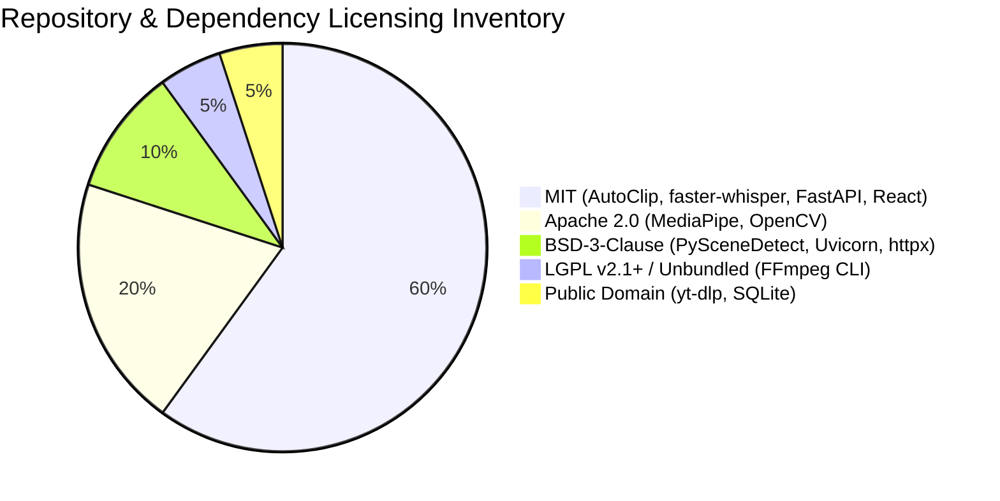

# ClipForge AI — Risks, Limitations & Mitigation Strategies

**Author:** ClipForge Architecture & Engineering Team  
**Date:** November 2026  
**Document Version:** 1.1.0 (Post-Validation Revision)  
**Phase:** Phase 1 — Research & Planning

---

## 1. Technical Risks & Engineering Mitigations

### 1.1 Windows 11 Native Performance & Thermal Throttling
- **Risk:** Long video transcription, computer-vision face tracking, and video encoding simultaneously running on a consumer Windows 11 laptop can cause thermal throttling, RAM exhaustion, and application crashes.
- **Mitigation:**
  1. **Strictly Sequential Pipeline:** Heavy stages never execute concurrently. Audio extraction completes before transcription begins; transcription finishes before highlight discovery; highlight discovery completes before video reframing.
  2. **Automated Hardware Profiling:** `HardwareDetector` dynamically checks CUDA availability and dedicated VRAM. If VRAM $< 4.0\text{ GB}$ or no NVIDIA GPU exists, it defaults to CPU execution with `compute_type="int8"` and selects lightweight models (`base` or `small`).
  3. **Zero Python Frame Buffering:** High-resolution video frames are never uncompressed into Python RAM. FFmpeg processes frames natively in optimized C/C++ memory spaces.
  4. **Downscaled Analysis:** `PySceneDetect` and MediaPipe face analysis run on 2x or 4x downscaled streams, cutting visual processing overhead by over 75%.

### 1.2 Word-Index Highlight Selection Limitations
- **Risk:** While word-index selection prevents the LLM from inventing fictional timestamps, it does **not** prevent:
  - Picking an index mid-sentence (grammatically truncated thoughts).
  - Out-of-bounds or inverted index values (`start_index > end_index`).
  - Candidate selections that are excessively short (<15s) or excessively long (>90s).
  - Selecting spans that contain long stretches of awkward silence.
- **Mitigation:**
  - **Deterministic 4-Rule Validation Pipeline:**
    1. *Index Bounds:* Validates $0 \le \text{start} < \text{end} < N$; discards invalid entries.
    2. *Sentence Completeness Snapping:* Automatically searches backward to the sentence start (capital letter or post-punctuation pause) and forward to terminal punctuation (`.`, `?`, `!`).
    3. *Physical Duration Enforcer:* Calculates $\Delta T = \text{words}[\text{end}].\text{end} - \text{words}[\text{start}].\text{start}$. Strictly caps duration between 15s and 90s.
    4. *Silence Gap Detection:* Flags or rejects clips containing unvoiced dead air $> 3.0\text{s}$.

### 1.3 Active Speaker Misidentification & Erratic Cropping
- **Risk:** In multi-person footage, visual face detection alone cannot tell who is speaking. Cropping naively can frame silent listeners, and rapid speaker alternation can cause dizzying camera pans.
- **Mitigation:**
  1. **Camera Shot Cut Protection:** `PySceneDetect` identifies visual camera cuts. Crop windows strictly jump at cut points and never pan across camera angle changes.
  2. **Lip Motion Analysis (Mouth Aspect Ratio):** On wide shots with multiple faces, MediaPipe Face Mesh lip landmarks measure dynamic opening variance over a 0.6s window to identify active articulation.
  3. **Minimum Dwell Time (2.5s):** The crop target is rate-limited, requiring at least 2.5 seconds before switching targets during continuous wide shots.
  4. **Balanced Center-Crop Fallback:** If speech confidence is ambiguous, or during simultaneous cross-talk, the system defaults smoothly to a balanced wide center crop.

### 1.4 Third-Party API Provider Uncertainty & Gateway Differences
- **Risk:** The specific external LLM endpoint, model, and gateway have not yet been established. Using an SDK locked to standard Anthropic or OpenAI endpoints will break if our friend's credentials run through a custom gateway, proxy, or LiteLLM router.
- **Mitigation:**
  1. **Universal Protocol Adapter:** Built on raw `httpx.AsyncClient`, supporting both Anthropic (`/v1/messages`) and OpenAI-compatible (`/v1/chat/completions`) protocols via a configuration flag (`CLIPFORGE_LLM_PROTOCOL`).
  2. **Configurable Base URL:** Supports arbitrary endpoints (`CLIPFORGE_LLM_API_BASE`).
  3. **Strict Credential Scrubbing:** Logging interceptor masks `Authorization`, `x-api-key`, and `api-key` headers, preventing accidental credential leaks in logs or UI responses.
  4. **Token Usage Metering:** Accumulates prompt and completion tokens from response payloads, tracking API cost per project.

---

## 2. Licensing & Intellectual Property Risks

### 2.1 License Boundary Audit
1. **`artbyjazi/autoclip`:** Permissive MIT License. Permitted for technical inspection, architectural reuse, and adaptation with standard copyright notice retention.
2. **`mutonby/openshorts`:**
   - Root codebase is MIT.
   - **CRITICAL RESTRICTION:** The `cloud/` subdirectory is governed by a proprietary commercial license that prohibits competing commercial services.
   - **Mitigation:** **The `cloud/` directory is strictly blacklisted and excluded.** No code from `cloud/` will ever be inspected, copied, or included in ClipForge AI.
3. **`paundrapf/PaunClip`:**
   - The repository contains **no license file** (All Rights Reserved under default copyright law).
   - **Mitigation:** **Zero code reuse.** We do not copy code, CSS, or internal assets from this project.
4. **`FFmpeg`:**
   - Distributed under LGPL v2.1+.
   - **Mitigation:** ClipForge interacts with FFmpeg exclusively via unbundled external CLI process calls (`subprocess`), completely avoiding proprietary static linking concerns.

---

## 3. Platform & Legal Risks (YouTube & Copyright)

### 3.1 YouTube Terms of Service & `yt-dlp` Reliability
- **Risk:** YouTube regularly updates stream ciphering and bot-detection heuristics, leading to temporary throttling or 403 Forbidden errors when using `yt-dlp`.
- **Mitigation:**
  1. **MVP Scope Refinement:** The MVP prioritizes **local file upload** (`.mp4`, `.mov`, `.mkv`), ensuring the core product is 100% functional without external streaming dependencies.
  2. **Clear Disclaimer:** The application will state that YouTube downloading is intended strictly for creators downloading their own content or public domain material.

---

## 4. Unresolved Decisions & Assumptions

| # | Domain | Open Decision / Assumption | Current Working Assumption | Validation & Next Steps |
| :--- | :--- | :--- | :--- | :--- |
| **1** | **API Credentials** | Unknown external LLM provider, base URL, and model name. | Assumed to be an HTTP-accessible gateway supporting either OpenAI or Anthropic payload format. | User will provide base URL, protocol, and key when ready. Connection tester in Settings will validate. |
| **2** | **Hardware Baseline** | Unknown user laptop specifications (CPU, RAM, GPU). | Assumed standard Windows 11 machine (8GB–16GB RAM, integrated or entry-level GPU). | Automated hardware detection configures CPU `int8` with `base`/`small` model by default. |
| **3** | **Active Speaker Precision** | Visual Lip Motion (MAR) vs. Deep Multimodal SyncNet. | Assumed MAR heuristic + Scene Cut Snapping covers 90%+ of standard creator footage with near-zero latency. | Benchmark MAR accuracy on test videos during Phase 4; evaluate deep audio-visual models only if needed post-MVP. |
| **4** | **Deployment Target** | Browser-based UI (`localhost:8000`) vs. standalone desktop bundle. | Assumed browser-based React UI served locally by FastAPI for MVP. | Decoupled architecture allows immediate packaging into Tauri or Electron post-MVP. |
| **5** | **Multi-Language Support** | Non-English video clipping. | Assumed English primary for MVP highlight discovery prompts. | Whisper inherently supports multi-language transcription; multi-language highlight prompts can be added post-MVP. |
