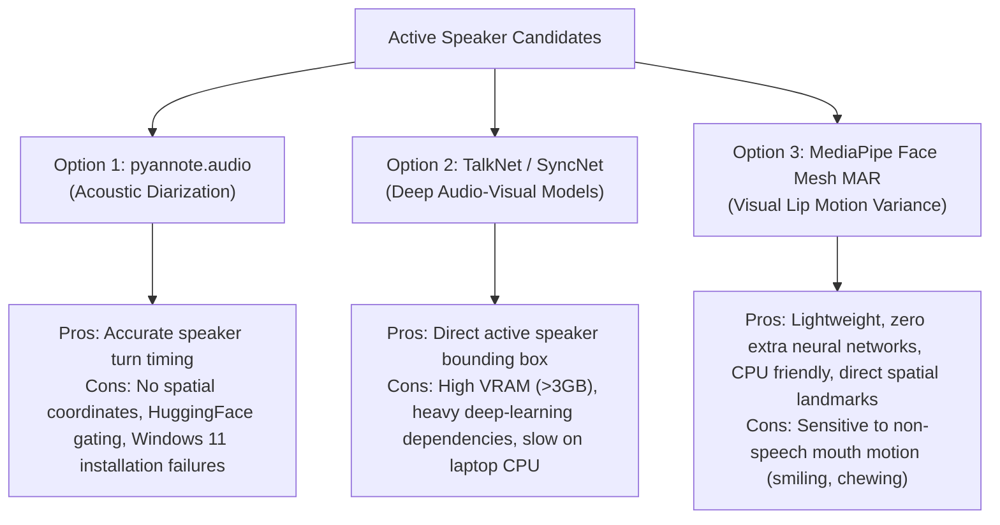
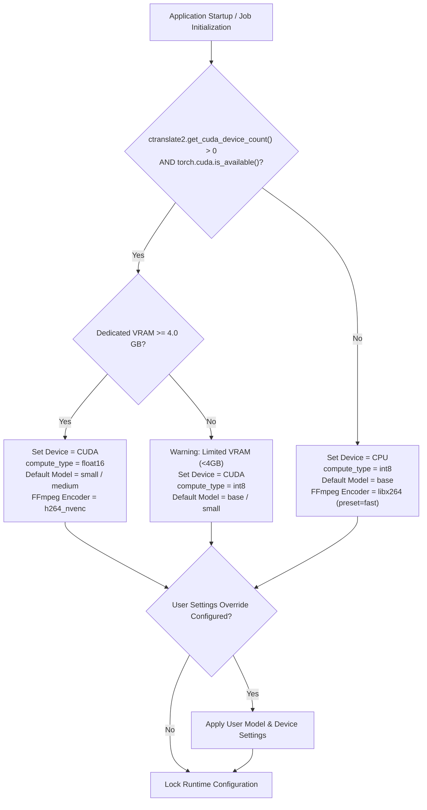

# ClipForge AI — Technology Stack Decisions & Justifications

**Author:** ClipForge Architecture & Engineering Team  
**Date:** November 2026  
**Document Version:** 1.1.0 (Post-Validation Revision)  
**Phase:** Phase 1 — Research & Planning

---

## 1. Stack Evaluation Matrix & License Audit

| Category | Recommended Choice | Upstream License | Commercial Usability | Decisive Rationale for Selection |
| :--- | :--- | :--- | :--- | :--- |
| **Backend Framework** | **Python (FastAPI + Pydantic v2)** | MIT | Permitted | High async I/O throughput; native integration with ML/media libraries; strict schema validation; auto-generated OpenAPI. |
| **Transcription Engine**| **`faster-whisper` (CTranslate2)** | MIT | Permitted | High inference speed on CPU/GPU via CTranslate2; native INT8 quantization; built-in Silero VAD; ~60% less VRAM than PyTorch Whisper. |
| **Video Engine** | **FFmpeg & FFprobe (CLI Subprocess)** | LGPL v2.1+ | Permitted (External unbundled CLI) | Subprocess execution complies with LGPL; hardware-accelerated encoding (NVENC/QSV/AMF); high-speed `libass` subtitle burning. |
| **Shot Detection** | **`PySceneDetect` (with PyAV)** | BSD 3-Clause | Permitted | Frame-accurate cut boundary detection; 2x–4x downscaling support; prevents jarring camera pans across cuts. |
| **Face & Speaker Tracking**| **`MediaPipe` Face Detection + Face Mesh (MAR)** | Apache 2.0 | Permitted | Runs on Windows 11 CPU with low resource usage; provides both face bounding boxes and lip landmarks for active speaker heuristic. |
| **Subtitles & Captions**| **Advanced SubStation Alpha (`.ass`) + `libass`** | Built into FFmpeg | Permitted | Millisecond-level karaoke word highlighting (`\k`); rendered in-stream at encoder level; avoids heavy Python rasterization. |
| **AI Abstraction Layer**| **Universal `httpx.AsyncClient` Adapter** | BSD 3-Clause | Permitted | Protocol-agnostic (supports OpenAI-compatible and Anthropic endpoints); custom base URLs; automatic secret redaction; token tracking. |
| **Frontend Framework** | **React (Vite) + TypeScript + Tailwind CSS** | MIT | Permitted | Responsive dark-themed UI; modular video players; instant HMR; decoupled from backend; desktop wrapper capable (Tauri/Electron). |
| **Data Persistence** | **SQLite (WAL Mode) + File Artifacts** | Public Domain | Permitted | Zero daemon configuration; WAL mode handles concurrent read/write locks; binary media artifacts stored cleanly on filesystem. |

---

## 2. Complete Dependency & License Inventory

The following table documents every third-party component intended for ClipForge AI, verifying commercial permissibility:

| Package / Tool | Version Target | License | Copyleft Risk | Action / Constraint |
| :--- | :--- | :--- | :--- | :--- |
| `fastapi` | `^0.115.0` | MIT | None | Direct dependency |
| `pydantic` | `^2.9.0` | MIT | None | Direct dependency |
| `uvicorn` | `^0.32.0` | BSD 3-Clause | None | Direct dependency |
| `faster-whisper` | `^1.1.0` | MIT | None | Direct dependency |
| `ctranslate2` | `^4.5.0` | MIT | None | Precompiled C++ engine |
| `scenedetect[av]` | `^0.6.4` | BSD 3-Clause | None | Direct dependency |
| `mediapipe` | `^0.10.18` | Apache 2.0 | None | Direct dependency |
| `opencv-python-headless` | `^4.10.0` | Apache 2.0 | None | Direct dependency |
| `httpx` | `^0.28.0` | BSD 3-Clause | None | Direct dependency |
| `ffmpeg` (binary) | `7.0+` (Gyant / BtbN) | LGPL v2.1+ | Safe via CLI | Execute via subprocess; do not link statically into proprietary C-extensions |
| `react` / `react-dom` | `^18.3.0` | MIT | None | Frontend dependency |
| `vite` | `^5.4.0` | MIT | None | Frontend build tool |
| `tailwindcss` | `^3.4.0` | MIT | None | Frontend styling |

### 2.1 Explicit Repository License Boundaries
1. **AutoClip (`artbyjazi/autoclip`):**
   - Core repository is licensed under **MIT**. Typography is licensed under the **SIL Open Font License**.
   - Permitted for commercial inspection, adaptation, and reuse with standard copyright notices.
2. **OpenShorts (`mutonby/openshorts`):**
   - Root codebase is licensed under **MIT**.
   - **EXPLICIT BLACKLIST / EXCLUSION:** The `cloud/` subdirectory is governed by an OpenShorts Commercial License that explicitly restricts commercial and competitive SaaS use. **No code from `cloud/` will ever be inspected, copied, or included in ClipForge AI.**
3. **PaunClip (`paundrapf/PaunClip`):**
   - Public repository contains **no license file** (All Rights Reserved under copyright law).
   - **EXPLICIT PROHIBITION:** Zero code reuse. No algorithms, UI components, or scripts may be incorporated.

---

## 3. Active Speaker Detection: Design Justification

### 3.1 The Flaw of Relying on Face Detection Alone
Face detection algorithms (MediaPipe, YOLOv8-face, Haar cascades) answer *"Where are human faces in this frame?"*. They do not answer *"Which person is currently talking?"*. In multi-speaker footage (podcasts, panels, interviews), cropping naively to detected faces causes erratic camera switching or framing a silent listener while another person speaks off-screen.

### 3.2 Evaluation of Candidate Solutions



### 3.3 The Selected MVP Solution
ClipForge implements **Option 3 (MediaPipe Lip Motion MAR) combined with PySceneDetect Shot Segmentation**:
1. **Shot Boundary Snapping:** When a shot cut occurs, the detector re-evaluates the active face. If only one face is present in that shot, it is automatically the active speaker.
2. **Mouth Aspect Ratio (MAR):** When multiple faces are present in a shot, lip landmarks are extracted to measure vertical-to-horizontal lip separation dynamics over a 0.6-second rolling window. The face with dynamic speech variance is framed.
3. **Minimum Dwell Time (2.5s) & Center Fallback:** Camera switches are rate-limited to avoid dizzying cuts. If confidence is ambiguous, the system defaults to a stable, aesthetic center crop.

---

## 4. Hardware Sizing, Detection & Fallback Strategy

Standard creator laptops vary wildly in compute capability. ClipForge AI implements **automatic runtime hardware detection**:



---

## 5. API Protocol Adaptability Specification

The LLM client abstraction layer must connect to arbitrary backends without assumptions:
1. **Configurable Base URL (`CLIPFORGE_LLM_API_BASE`):** Accepts standard URLs (`https://api.anthropic.com`, `https://api.openai.com/v1`, `https://openrouter.ai/api/v1`) or custom internal/local proxies (e.g., `http://192.168.1.100:8000/v1`).
2. **Configurable Protocol (`CLIPFORGE_LLM_PROTOCOL`):**
   - `openai_compatible`: Transmits to `/v1/chat/completions` using `Authorization: Bearer <KEY>`.
   - `anthropic`: Transmits to `/v1/messages` using `x-api-key: <KEY>` and `anthropic-version: 2023-06-01`.
3. **Security & Redaction:** All HTTP request headers and error dumps pass through an in-memory scrubber:
   ```python
   def sanitize_headers(headers: dict) -> dict:
       masked = {}
       for k, v in headers.items():
           if k.lower() in ("authorization", "x-api-key", "api-key", "token"):
               masked[k] = "***REDACTED***"
           else:
               masked[k] = v
       return masked
   ```

---

## 6. Reproducible Benchmarking Plan

All performance figures must be empirically verified rather than assumed:
- **Test Video A:** 5-minute solo presentation (1080p30, H.264, 16kHz audio).
- **Test Video B:** 5-minute two-person podcast (1080p30, H.264, 16kHz audio).
- **Benchmark Script:** `scripts/run_benchmarks.py` will execute across both CPU-only and GPU profiles, measuring:
  1. Audio extraction time (s).
  2. Transcription RTF and peak RAM/VRAM across `tiny`, `base`, `small`, and `medium`.
  3. Active speaker detection frame rate (FPS).
  4. 1080x1920 export FPS and total render duration comparing `libx264` vs. `h264_nvenc`.
